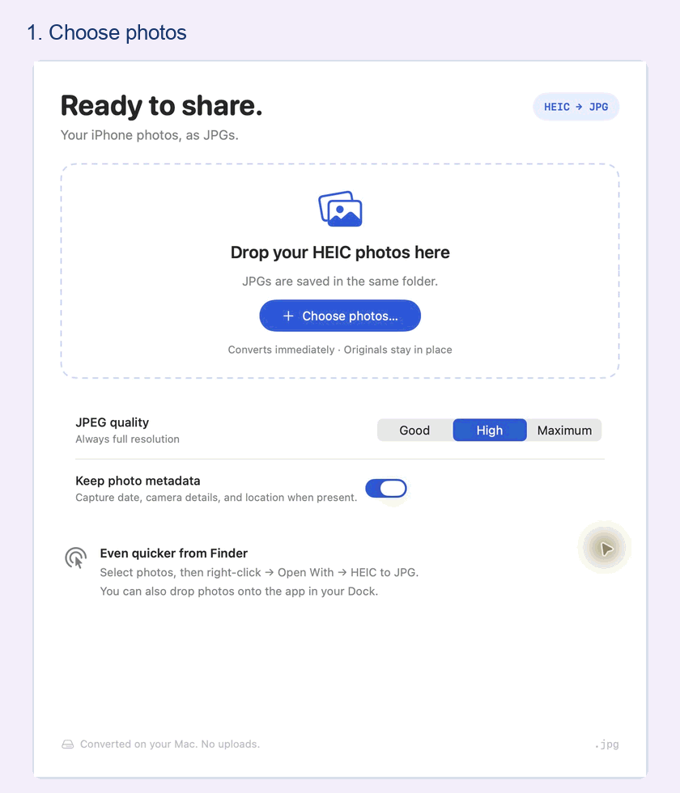

# HEIC to JPG


Turn iPhone HEIC/HEIF photos into JPGs beside the originals. A native Mac app with batch conversion, drag-and-drop, and Finder **Open With**. Everything happens on your Mac.

**macOS 13+ · Swift + SwiftUI · MIT license**



*Actual app captures using synthetic photos. [View still screenshots](docs/images/README.md).*

## Build and launch

Requires Xcode or the Xcode Command Line Tools with Swift 5.9+. Signed downloads and an App Store release are still in preparation.

```sh
git clone https://github.com/XiupengMa/HEIC_2_JPEG_MacOS.git
cd HEIC_2_JPEG_MacOS
bash scripts/build.sh
open "dist/HEIC to JPG.app"
```

For everyday use, drag the app into **Applications** and launch **HEIC to JPG** from Spotlight or your Dock.

## Convert from Finder

Select your HEIC photos, then **right-click → Open With → HEIC to JPG**.


If the app is not listed, choose **Other…** and select it. You can also drop photos onto its Dock icon.

## Choose quality and metadata


Full resolution at every quality setting. **High** is the default. Metadata is kept by default, including location when present; turn it off to omit capture details.

## Find JPGs beside the originals


Existing files are kept; repeated conversions create numbered names such as `Photo 01 (1).jpg`. Use **Show in Finder** to reveal your copies.

[Controls and conversion details](docs/USAGE.md) explain orientation, metadata, quality, and supported photos. Export files from Photos first and download iCloud files before converting. JPEG exports are lossy still images.

<details>
<summary><strong>Development and App Store preparation</strong></summary>

Open `HEICToJPG.xcodeproj` for the native app, or `Package.swift` for the converter and its tests.

```sh
bash scripts/test.sh
bash scripts/build.sh --sandbox
open "dist/HEIC to JPG Sandbox.app"
```

The sandbox preview asks for its containing folder and remembers access. App Store signing needs a developer team and final bundle ID. The standalone builds use ad-hoc signing for local use.

[Development guide](docs/DEVELOPMENT.md) · [App Store guide](docs/APP_STORE.md) · [Validation results](docs/VALIDATION.md) · [CI checks](https://github.com/XiupengMa/HEIC_2_JPEG_MacOS/actions)

</details>

[Contributing](CONTRIBUTING.md) · [Release guide](docs/RELEASING.md) · [Privacy](docs/PRIVACY.md) · [Security](SECURITY.md) · [Changelog](CHANGELOG.md) · [MIT license](LICENSE)
