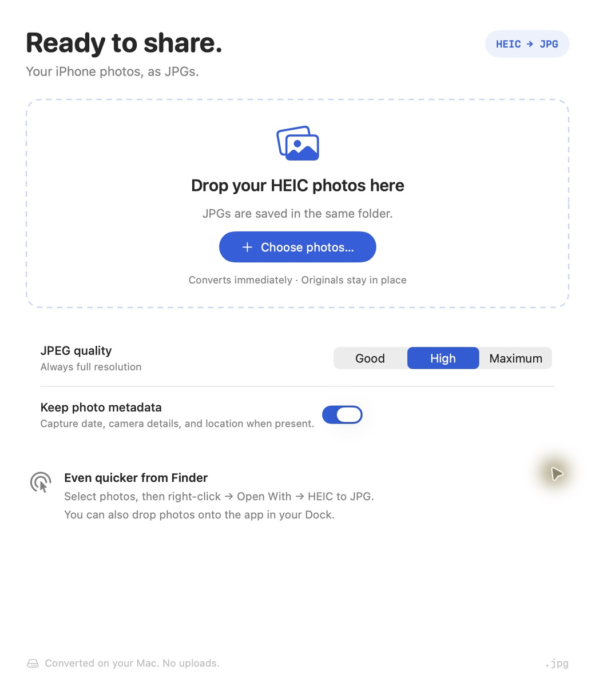
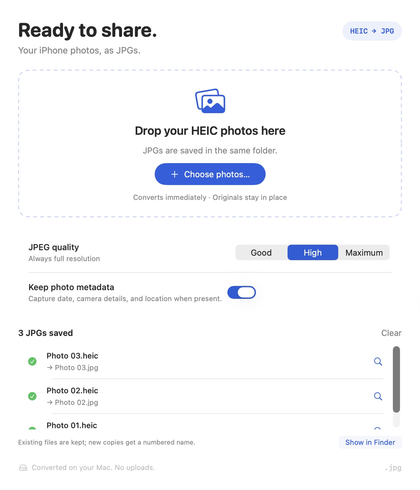
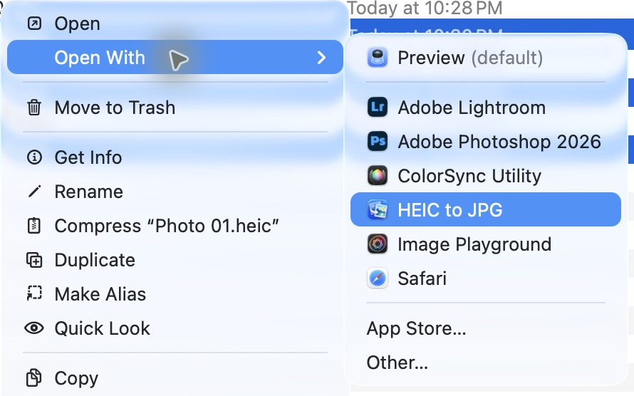
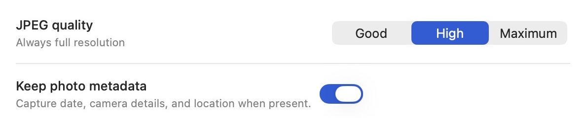
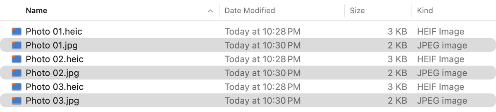

# README screenshots

These are captures of the actual macOS application and Finder, using three copies of the repository's synthetic HEIC fixture named `Photo 01.heic`, `Photo 02.heic`, and `Photo 03.heic`. The captures contain no personal photos.

## Still screenshots

### Ready to convert

### Conversion complete

### Finder shortcut

### Quality and metadata

### Same-folder output

## Capture and regenerate

The GIF assembles four captured states with readable pauses; it is a walkthrough, not a measurement of conversion speed. Screenshots are cropped and resized to focus on the relevant UI. App-control overlays and Finder sidebars are excluded. The app UI, filenames, and conversion results are preserved.

1. Build and launch the local app. In an ignored demo folder, copy `Tests/ConversionCoreTests/Fixtures/photo.heic` three times using the filenames above.
2. Capture the ready screen, the picker with all three HEICs selected, the successful conversion screen, Finder with the original/JPG pairs, and Finder's Open With menu with HEIC to JPG highlighted.
3. Keep raw captures in `.build/readme-captures` as `01-ready.png`, `02-picker.png`, `03-converted.png`, `04-folder.png`, and `05-open-with.png`.
4. From the repository root, run `python3 scripts/prepare-readme-media.py .build/readme-captures`. This requires Pillow. The script's crop coordinates match the captured Retina windows; update the coordinates for a different window size.
5. Visually check every GIF frame and PNG for readability and personal data before committing the output.

The committed media is covered by the project's MIT license. Raw captures and demo photos remain ignored.

[Back to the README](../../README.md)
